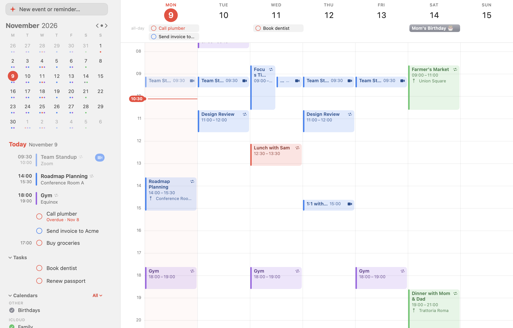
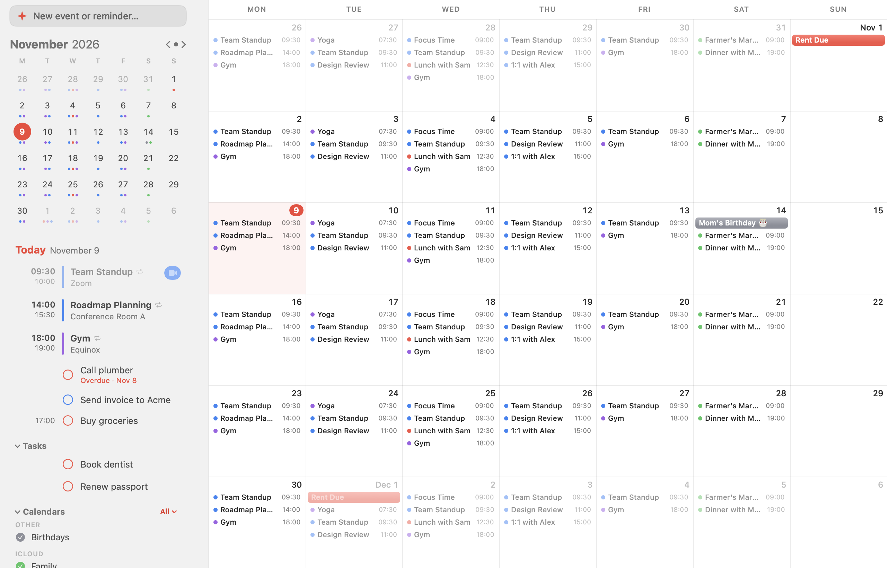
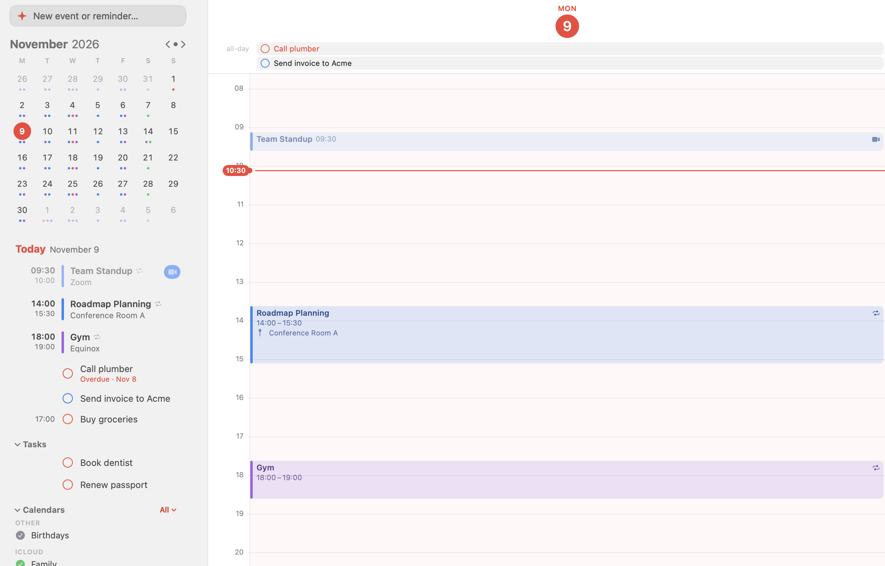
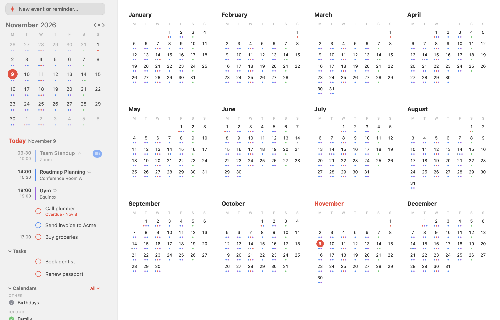
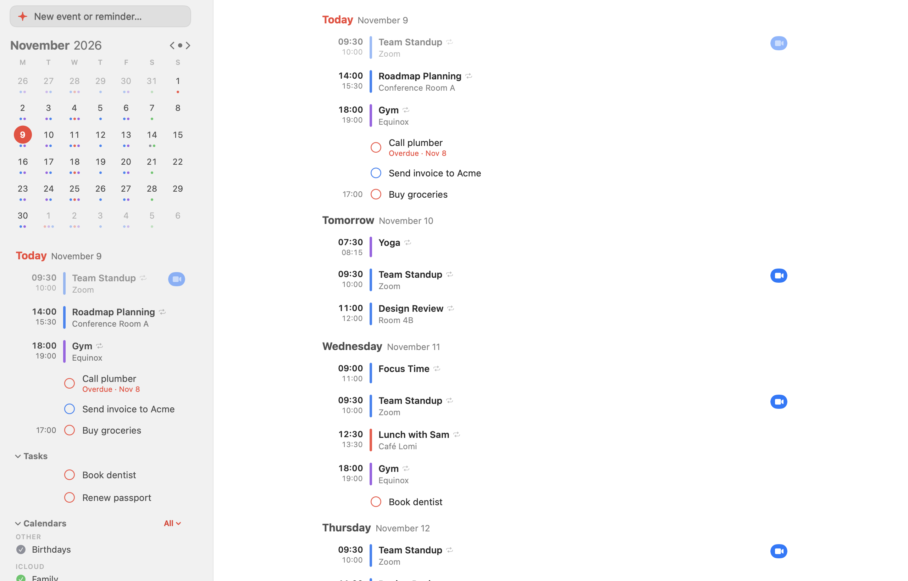
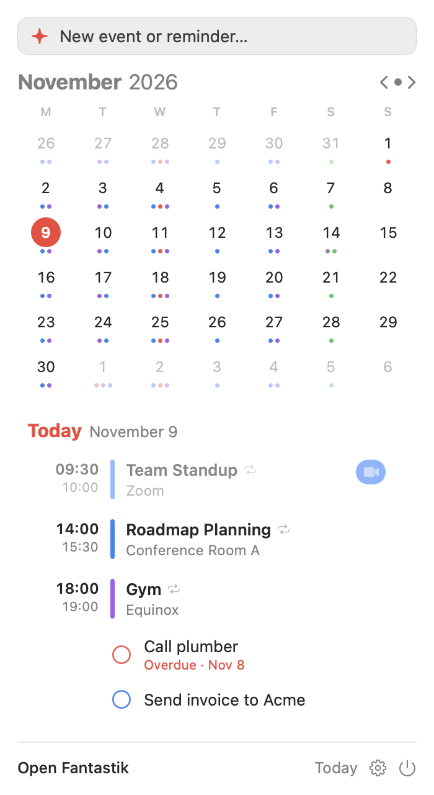
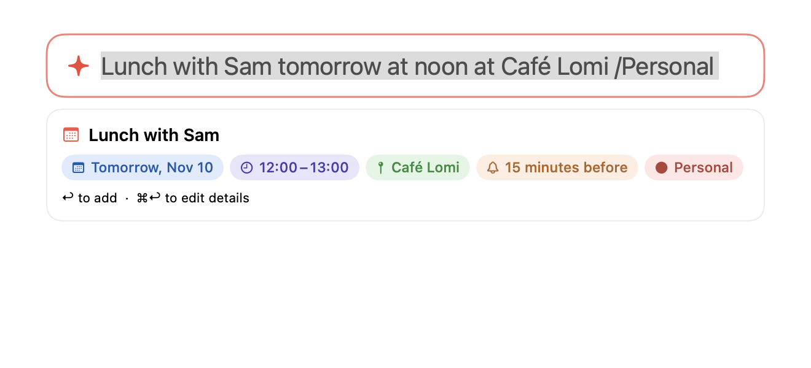
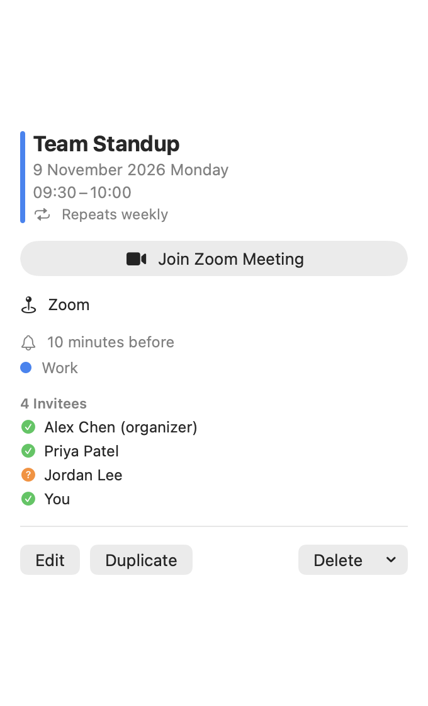
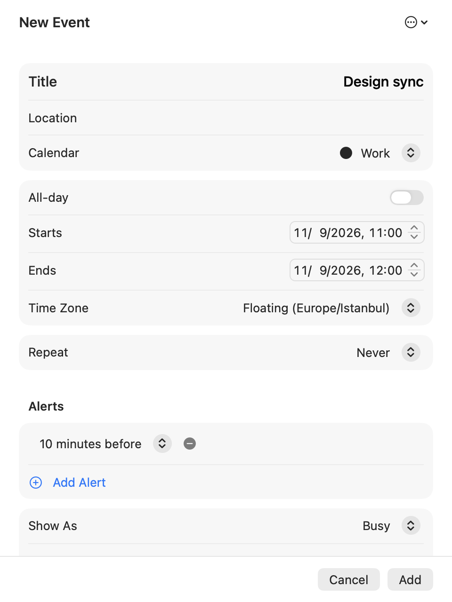

# Fantastik

A fast, polished, native calendar app for **macOS on Apple silicon**, written in SwiftUI on top of EventKit. It works with every calendar and reminder account you've already added to macOS (iCloud, Google, Microsoft Exchange, Yahoo, CalDAV) and adds natural-language entry, a menu bar mini window, calendar sets, weather, and more. There is no server component and no subscription.



## Features

- **Five views**: Day, Week, Month, Year and a scrolling List. Drag in the grid to create events, drag to move them, drag the bottom edge to resize, pinch to zoom the hour height.
- **Natural-language entry**: type `Lunch with Sam tomorrow at noon at Café Lomi /Personal alert 15 minutes before` and see it parsed live. ⌘↩ opens the full editor. See [docs/NATURAL_LANGUAGE.md](docs/NATURAL_LANGUAGE.md).
- **Quick entry anywhere**: press **⌃⌥Space** from any app for a floating entry panel.
- **Menu bar mini window** with month, agenda, and entry field. Optionally shows your next event in the menu bar.
- **Reminders and tasks** shown inline with events, with checkboxes.
- **Calendar sets**: switch between groups of calendars (Work, Personal, …).
- **Weather forecast** in day headers (Open-Meteo, no API key) and **travel time** to event locations (MapKit).
- **Time zones**: per-event time zone and a world clock in the sidebar.
- **Event templates** and an **Openings finder** that lists your free slots and copies them as shareable text.
- **Meeting links**: one-click Join for Zoom, Google Meet, Microsoft Teams, Webex, FaceTime and more.
- **Interesting calendars**: moon phases and US holidays, computed locally.
- **Search**, repeat rules (including custom), multiple alerts, invitees (read-only), dynamic dock icon showing today's date.

| Month | Day |
| --- | --- |
|  |  |

| Year | List |
| --- | --- |
|  |  |

| Menu bar | Quick entry |
| --- | --- |
|  |  |

| Event details | Event editor |
| --- | --- |
|  |  |

> All screenshots use built-in sample data (fictional people and places), never real calendars.

## Install

**From the DMG** (recommended): download `Fantastik-1.0.dmg` from the [Releases](../../releases) page, open it and drag **Fantastik** into **Applications**.

The app is ad-hoc signed, not notarized. If macOS says it can't verify the app, right-click it and choose **Open**, or run:

```bash
xattr -dr com.apple.quarantine /Applications/Fantastik.app
```

**From source:**

```bash
git clone https://github.com/cembaylam/Fantastik.git
cd Fantastik
./scripts/build.sh            # builds build/Fantastik.app
open build/Fantastik.app
```

Create the installer yourself with `./scripts/make-dmg.sh` (outputs `build/Fantastik-<version>.dmg`).

## Requirements

- Apple silicon Mac (arm64)
- macOS 26 or later
- Xcode 26+ command line tools (to build from source)

## Connecting calendars

Fantastik reads calendars through macOS, so add accounts in **System Settings → Internet Accounts** (there is an *Add Calendar Account…* shortcut in the sidebar's calendar menu and in Settings). On first launch grant Calendar and Reminders access when prompted. No credentials are ever handled by the app.

Want to look around first? Choose **Explore with Sample Data** on the welcome screen, or run `build/Fantastik.app/Contents/MacOS/Fantastik --demo`.

## Keyboard shortcuts

| Action | Shortcut |
| --- | --- |
| Quick entry from anywhere | ⌃⌥Space |
| New event (focus entry field) | ⌘N |
| New event with details | ⇧⌘N |
| Today | ⌘T |
| Previous / next | ⌘[ / ⌘] |
| Day, Week, Month, Year, List | ⌘1 – ⌘5 |
| Find openings | ⌥⌘O |
| Search | ⌘F |
| Edit selected event | ⌘E |

## Development

```bash
swift build            # debug build
swift test             # parser tests
./scripts/build.sh     # release .app bundle
```

To regenerate the README screenshots (offscreen, sample data only):

```bash
swift build -c release --arch arm64
.build/out/Products/Release/Fantastik --snapshot "$PWD/docs/screenshots"
```

To use your own app icon, place an `AppIcon.icns` in `Resources/` before building. See [docs/ARCHITECTURE.md](docs/ARCHITECTURE.md) for how the code is organized.

## Limitations

- Calendar invitees can be displayed but not added; Apple's EventKit does not allow it.
- Travel time is estimated live and not stored on the event, for the same reason.
- Not notarized; see the install notes above.

## License

[MIT](LICENSE)
